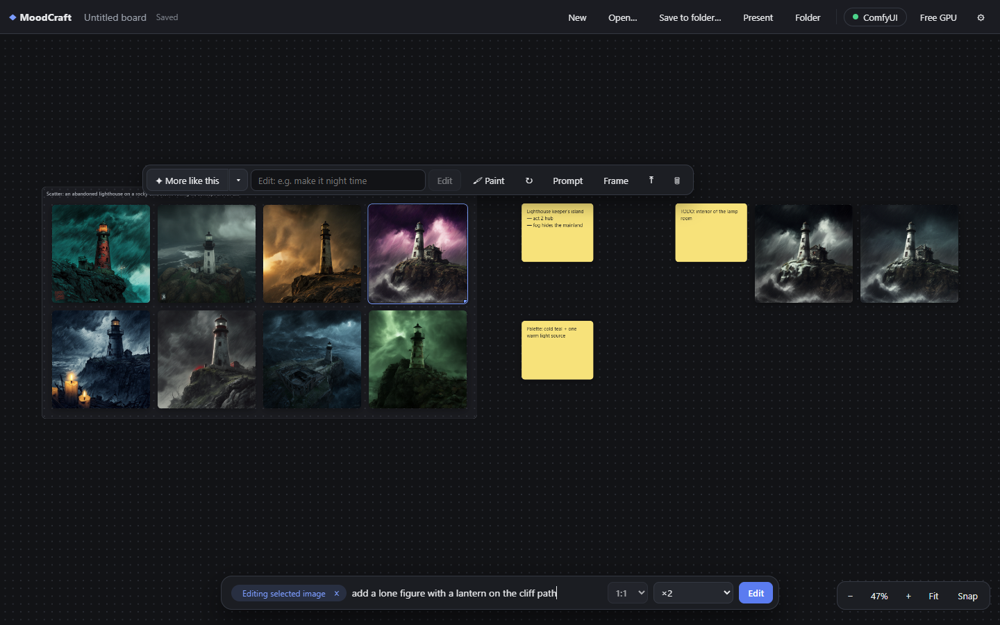
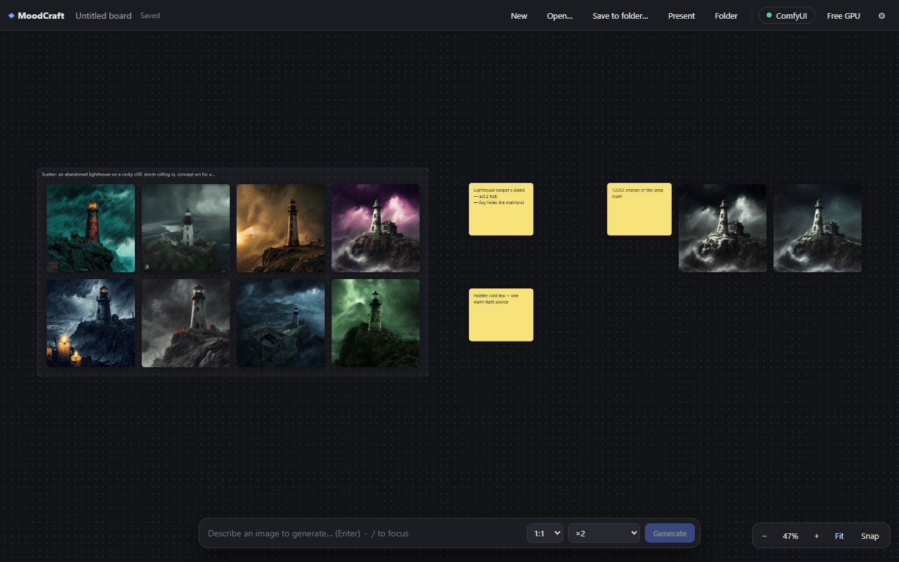

# MoodCraft

**An infinite moodboard that generates images on your own GPU.**

MoodCraft is a desktop app for concept art, mood boards and project planning.
You lay out images, notes and frames on an endless canvas, and generate new
images right on the board. Generation runs through a **ComfyUI** on your own PC,
so nothing goes to the cloud and there's no account or subscription. It's
in the spirit of Google Mixboard, but local.



- **Generate on the board**: type a prompt, get one to four images where you are looking, or **Scatter** 8 or 12 different takes into a frame.
- **Edit by describing the change**: "make it night", "add a red scarf". Or **remix** several images ("put the pattern from image 2 on the jacket in image 1").
- **Paint to edit**: brush over a region, describe what goes there; the rest of the image stays pixel-identical.
- **More like this**: variations fanned around the original, from subtle to loose.
- **Boards are plain folders** (`board.json` + PNGs), easy to back up, sync or put in git.
- **Present**: export the board as a self-contained HTML slide deck (prints to PDF).

Windows 10/11 with an NVIDIA GPU is the tested setup (developed on an RTX 5070,
12 GB). The code is cross-platform Tauri, but macOS and Linux builds are untested.

## Contents

- [Features](#features)
- [Install](#install)
- [Setting up ComfyUI](#setting-up-comfyui)
- [Recommended models](#recommended-models)
- [Keyboard and mouse](#keyboard-and-mouse)
- [Using the same graphs inside ComfyUI](#using-the-same-graphs-inside-comfyui)
- [Boards on disk](#boards-on-disk)
- [How it talks to ComfyUI](#how-it-talks-to-comfyui)
- [Building from source](#building-from-source)
- [License](#license)

## Features

| Feature | How |
| --- | --- |
| Generate | Type in the prompt bar at the bottom and press **Enter**. Pick the aspect ratio and ×1–×4. New cards appear in view and show queue position and sampling progress; you can keep working while they render. |
| Scatter | Pick **Scatter ×8** or **×12** in the count menu. Each take adds its own lighting, camera angle, palette, medium and mood words and a new seed, laid out in a grid inside a new frame titled with your prompt. |
| Edit an image | Select an image, then type the change in the prompt bar (or **Edit** in its toolbar). Flux Klein uses the image as a reference, so the result follows your instruction. |
| Remix several images | Shift/Ctrl-click two or more images; the click order numbers them (**1**, **2**, …). Then type, e.g. "put the patch from image 2 on the jacket in image 1". Image 1 sets the output shape. Flux Klein only. |
| More like this | Select an image → **✦ More like this**. New variations (same prompt, new seeds) are fanned around the original. **▾** sets how many and the strength, from subtle (keeps the composition) to loose (keeps the idea). |
| Paint to edit (inpaint) | Select an image → **🖌 Paint**. Brush over the part to change, describe what goes there, **Inpaint**. Only the painted area changes. |
| Re-roll | Select a generated image → **↻** (same prompt, new seed). |
| Add images | Drag files from Explorer; **Ctrl+V** an image, a link to an image (downloaded into the board) or a `data:image` URL. A link that isn't an image becomes a note. Right-click → **Camera…** takes a webcam snapshot. |
| Notes and frames | **N** / **F**, or right-click empty canvas → **Add note** / **Add frame**. Double-click a note to edit it. Moving a frame moves what's inside. |
| Subboards | Right-click → **Add subboard**. Its card shows a mosaic of its images; double-click to go in, and use the breadcrumb in the top bar to go back. |
| View large | Double-click an image. **←/→** step through the board's images in reading order; **Esc** closes. |
| Group resize | Select several items and drag any corner handle (or the dashed selection box's handle): the whole group scales together and keeps its arrangement. |
| Present | **Present** (top bar) writes `<board> - deck.html` next to the board folder and opens it: a title slide, one slide per frame, then loose items. **Print / PDF** gives one landscape page per slide. |
| Free GPU | **Free GPU** (top bar) asks ComfyUI to unload its models, so Blender or a game engine gets the VRAM back. MoodCraft also does this when it closes. |
| Undo | Every action is undoable (**Ctrl+Z** / **Ctrl+Y**). Everything autosaves. |



Generation jobs survive a restart: cards that were still rendering re-attach to
their ComfyUI job when you reopen the board. ComfyUI errors (including GPU
out-of-memory) appear on the card with a **Retry** button.

## Install

### Prerequisites

1. **Windows 10 or 11** with an NVIDIA GPU (8 GB of VRAM or more for the
   recommended Flux Klein models; 12 GB is comfortable).
2. **ComfyUI**, see [Setting up ComfyUI](#setting-up-comfyui).
3. **Microsoft Edge WebView2 Runtime**. It ships with Windows 11 and current
   Windows 10; the installer downloads it if it's missing.

### Installer

Download `MoodCraft_<version>_x64-setup.exe` (or the `.msi`) from the Releases
page and run it.

The installer is **not code-signed**, so Windows SmartScreen shows "Windows
protected your PC". Click **More info → Run anyway**. If you'd rather not, build
it yourself; see [Building from source](#building-from-source).

The installer is small (about 1.8 MB for the `.exe`, 2.7 MB for the `.msi`; 5.6 MB
installed) because it uses the system WebView2 rather than bundling a browser.
It installs per user, with no admin rights needed, and adds a Start menu entry and an
uninstaller. Your boards and settings in `%APPDATA%\com.sunsh.moodcraft` are
kept when you uninstall.

### First launch

1. Start ComfyUI.
2. Start MoodCraft. The status pill in the top bar turns **green** once ComfyUI
   answers.
3. Open **⚙ → Models**, pick the family (Flux Klein is the default) and check
   that each dropdown shows the right file. **Test** renders a tiny image with
   your selection; **Save** keeps it.
4. Type a prompt and press Enter.

MoodCraft queues a one-step warm-up image when it connects, so the models are
loaded before your first real image.

## Setting up ComfyUI

MoodCraft doesn't bundle a model runtime; it drives a ComfyUI that you run. It
uses **core nodes only**. No custom nodes, no ComfyUI-Manager installs.
Use a recent ComfyUI (tested with 0.42–0.44): the Flux Klein graphs need
`ReferenceMultiLatent` and `EmptyFlux2LatentImage`.

### 1. Install ComfyUI

Pick one:

- **Comfy Desktop** (easiest): download it from
  [comfy.org/download](https://www.comfy.org/download), install, and let it set up
  a ComfyUI. It listens on `http://127.0.0.1:8188` by default.
- **ComfyUI portable or a git install**: follow the
  [ComfyUI README](https://github.com/comfyanonymous/ComfyUI#installing). Start it
  with `python main.py` (or the portable `.bat`).

### 2. Put the model files in place

ComfyUI looks for models in its `models` folder. For Flux Klein:

```
ComfyUI/models/
  diffusion_models/flux3-image-klein-base-int8-convrot.safetensors
  text_encoders/qwen3vl_4b_int8_convrot.safetensors
  vae/flux2-vae.safetensors
```

For an SDXL checkpoint:

```
ComfyUI/models/checkpoints/sd_xl_base_1.0.safetensors
```

Download links and sizes are in [Recommended models](#recommended-models).
Restart ComfyUI (or press **R** in its UI to refresh the model lists) after
adding files, then click **Re-check** under ⚙ → ComfyUI in MoodCraft.

### 3. Models on another drive (optional)

Model files are large, so you might keep them on another drive.

- **Comfy Desktop**: add the drive as an extra model storage folder in Comfy
  Desktop's settings. It writes the paths into its own `extra_model_paths`
  config for you.
- **Other installs**: copy `extra_model_paths.yaml.example` in the ComfyUI folder
  to `extra_model_paths.yaml` and add an entry:

  ```yaml
  my_models:
    base_path: D:/AI/models
    diffusion_models: diffusion_models/
    text_encoders: text_encoders/
    vae: vae/
    checkpoints: checkpoints/
  ```

  Or start ComfyUI with `--extra-model-paths-config path/to/file.yaml`.

### 4. Port and URL

MoodCraft expects `http://127.0.0.1:8188`. If your ComfyUI runs on another port
or machine, set the URL in **⚙ → ComfyUI**. For another machine, start
ComfyUI with `--listen` and make sure the port is reachable. Only do that on a
network you trust: ComfyUI has no authentication.

### 5. VRAM and Free GPU

ComfyUI keeps models loaded between generations, so the second image is much
faster than the first. With Flux Klein int8 on an RTX 5070 (12 GB) a warm
768² image takes about 6 seconds. **Free GPU** in the top bar unloads them
when you need the VRAM for something else. The next image loads them again.

Generated files are written to ComfyUI's output folder under
`board/<board name>/`, and images sent for editing are uploaded to its `input`
folder under `board/`. That keeps them apart from your other ComfyUI work. The
board itself keeps its own copy of every image.

### Troubleshooting

| Symptom | What to do |
| --- | --- |
| Status pill is **red** ("ComfyUI offline") | ComfyUI isn't running or isn't at the URL in ⚙. Start it; MoodCraft reconnects on its own. You can keep arranging the board meanwhile. |
| Status pill is **amber** | ComfyUI answers but something is missing. Hover the pill or open ⚙ to see which node or model file. A missing node means your ComfyUI is too old: update it. A missing model means the file isn't in a folder ComfyUI scans (see step 2 and 3), or ⚙ → Models points at a different file name. |
| A card shows **out of memory** | Click **Free GPU**, close other GPU-heavy apps (games, Blender, a second ComfyUI), lower the size or count, then **Retry**. The int8 Flux Klein files are the smallest that work well; 8 GB cards should stick to ×1–×2. |
| The first image takes minutes | The models are being read from disk: about 11 GB for Flux Klein. From a USB drive or spinning disk this can take several minutes. Later images are fast while ComfyUI keeps them loaded. Keep models on an internal SSD if you can, and avoid Free GPU unless you need the VRAM. |
| Cards stay on "Queued" | Something else is using the ComfyUI queue (another tab or app). MoodCraft's jobs run when it gets to them; **Cancel** on a card removes only that job. |
| Edits look like copies of the original | Use Flux Klein (the Checkpoint family has no reference edit) and phrase the prompt as a change: "make it winter", not "a winter scene". |
| Image or text looks garbled | The text encoder doesn't match the diffusion model. In ⚙ → Models, pick the encoder listed for the family and press **Test**. |

## Recommended models

### Flux Klein (default family)

Black Forest Labs' FLUX 3 Image Klein in the int8 builds that ComfyUI's own
templates use. These are the exact files MoodCraft is developed and tested with.

| Role | File | Size | Folder | Download |
| --- | --- | --- | --- | --- |
| Diffusion model | `flux3-image-klein-base-int8-convrot.safetensors` | 5.8 GB | `models/diffusion_models/` | [Hugging Face](https://huggingface.co/black-forest-labs/flux-3-image-klein-comfy/resolve/main/diffusion_models/flux3-image-klein-base-int8-convrot.safetensors) |
| Text encoder (Qwen3-VL 4B, type `flux3`) | `qwen3vl_4b_int8_convrot.safetensors` | 4.9 GB | `models/text_encoders/` | [Hugging Face](https://huggingface.co/black-forest-labs/flux-3-image-klein-comfy/resolve/main/text_encoders/qwen3vl_4b_int8_convrot.safetensors) |
| VAE | `flux2-vae.safetensors` | 336 MB | `models/vae/` | [Hugging Face](https://huggingface.co/black-forest-labs/flux-3-image-klein-comfy/resolve/main/vae/flux2-vae.safetensors) |

All three are in Black Forest Labs' official
[flux-3-image-klein-comfy](https://huggingface.co/black-forest-labs/flux-3-image-klein-comfy)
repository. It is **gated**: sign in to Hugging Face and accept the license on
that page first, or the links return "401 Unauthorized". The weights are
under BFL's own license (`flux-kommunity-license`), so read it before using
the output commercially. The VAE is also available ungated from
[Comfy-Org/flux2-dev](https://huggingface.co/Comfy-Org/flux2-dev/resolve/main/split_files/vae/flux2-vae.safetensors).

**VRAM:** tested on 12 GB (RTX 5070), including ×4 batches at 768² and
Scatter ×12. BFL quotes 8 GB as the minimum for the int8 builds. The repository
also has bf16 (11 GB, for 24 GB+ cards) and nvfp4 (5.3 GB, RTX 50-series)
builds of the same model; pick them in ⚙ → Models if you use them.

The repo also has a step-distilled `flux3-image-klein-int8-convrot` (4–16
steps). It works, but MoodCraft's defaults (20 steps, CFG 3.5) are tuned for
the **base** model, so lower the steps and CFG in ⚙ if you switch.

### Checkpoint family (SD 1.5 / SDXL)

Any single-file checkpoint works for generate, More like this and Paint to
edit. Edit and Remix need Flux Klein.

| Checkpoint | Size | VRAM | Download | Notes |
| --- | --- | --- | --- | --- |
| SDXL 1.0 base | 6.9 GB | 8 GB+ | [Hugging Face](https://huggingface.co/stabilityai/stable-diffusion-xl-base-1.0/resolve/main/sd_xl_base_1.0.safetensors) | Stability AI's reference model (CreativeML Open RAIL++-M). Tested. |
| Juggernaut XL v9 | 7.1 GB | 8 GB+ | [Hugging Face](https://huggingface.co/RunDiffusion/Juggernaut-XL-v9/resolve/main/Juggernaut-XL_v9_RunDiffusionPhoto_v2.safetensors) | Popular photoreal SDXL fine-tune by RunDiffusion. Not tested with MoodCraft. |

Put them in `models/checkpoints/`. Defaults for this family: 1024², 25 steps,
CFG 6.5, dpmpp_2m / karras.

### Choosing models in the app (⚙ → Models)

Pick a **model family**, then the files. The dropdowns list what your ComfyUI
actually has, and switching family preselects files that match by name.
**Test** renders a 4-step 256² image with the selection, so a mismatched encoder
shows up here rather than on a card. **Save** stores the choice in
`%APPDATA%\com.sunsh.moodcraft\models.json`.

| Family | Loaders | Generate | Edit / Remix | More like this | Paint | Defaults |
| --- | --- | --- | --- | --- | --- | --- |
| Flux Klein | diffusion model + text encoder (`flux3`) + VAE | ✓ | ✓ | ✓ | ✓ | 768², 20 steps, CFG 3.5, euler/simple; edit CFG 1; strength 0.7 |
| Checkpoint | one checkpoint file | ✓ | – | ✓ | ✓ | 1024², 25 steps, CFG 6.5, dpmpp_2m/karras; strength 0.6 |

## Keyboard and mouse

| Canvas | |
| --- | --- |
| Pan | Space-drag, middle-drag or right-drag; trackpad two-finger scroll |
| Zoom | Mouse wheel; trackpad pinch · **Ctrl+0** fit all · **1** 100% |
| Select | Click · **Shift/Ctrl-click** add · drag a box on empty canvas · **Ctrl+A** all |
| Move / resize | Drag a card · drag its corner handle (images keep their aspect ratio) · with several selected, any handle scales the group |
| Context menu | Right-click empty canvas: Add note, Add frame, Add subboard, Camera… |
| View large | Double-click an image |
| Open subboard | Double-click its card |

| Keys | |
| --- | --- |
| **Enter** in the prompt bar | Generate (or edit / remix the selected images) |
| **/** | Focus the prompt bar |
| **N** / **F** | New note / frame around the selection |
| **Del** | Delete selection |
| **Ctrl+D** | Duplicate |
| **Ctrl+Z** / **Ctrl+Y** (or **Ctrl+Shift+Z**) | Undo / redo |
| **G** | Snap to grid on/off |
| **Ctrl+S** / **Ctrl+Shift+S** / **Ctrl+O** | Save now / Save to folder / Open board |
| **Esc** | Clear selection, close panels |

| Viewer (double-click an image) | |
| --- | --- |
| **←/→**, **↑/↓**, wheel | Previous / next image |
| **Home** / **End** | First / last |
| **Esc**, click backdrop | Close |

| Paint to edit | |
| --- | --- |
| **[** / **]** | Smaller / bigger brush |
| **B** / **E** | Brush / eraser |
| **Ctrl+Z** | Undo stroke |
| **Esc** | Cancel |

## Using the same graphs inside ComfyUI

The [`comfyui-workflows/`](comfyui-workflows/) folder has every graph MoodCraft
sends, as normal ComfyUI workflows. Drag one onto the ComfyUI canvas (or
**Workflow → Open**) and press **Run**. They're for people who want to use or
tweak the same pipelines inside ComfyUI directly. **The app doesn't need
them**: it carries its own copies.

| | Flux Klein | SDXL checkpoint |
| --- | --- | --- |
| Text to image | [text-to-image.json](comfyui-workflows/flux-klein/text-to-image.json) | [text-to-image.json](comfyui-workflows/sdxl-checkpoint/text-to-image.json) |
| Edit | [edit.json](comfyui-workflows/flux-klein/edit.json) | – |
| Remix (2+ references) | [remix.json](comfyui-workflows/flux-klein/remix.json) | – |
| More like this (img2img) | [more-like-this.json](comfyui-workflows/flux-klein/more-like-this.json) | [more-like-this.json](comfyui-workflows/sdxl-checkpoint/more-like-this.json) |
| Paint to edit (inpaint) | [inpaint.json](comfyui-workflows/flux-klein/inpaint.json) | [inpaint.json](comfyui-workflows/sdxl-checkpoint/inpaint.json) |

Each one is grouped into Models, Input images, Prompt, Sampling and Output, and
has a note explaining its settings. They use the model file names above. The
**Load Image** nodes point at the sample pictures in
[`comfyui-workflows/example-inputs/`](comfyui-workflows/example-inputs/): copy
those into `ComfyUI/input/` to run a workflow as is, or pick your own image. For
inpainting the mask is a black-and-white image (white = change).

## Boards on disk

A board is a folder:

```
MyBoard/
  board.json        cards, positions, prompts, seeds, camera
  assets/*.png      generated, dropped and pasted images (and inpaint masks)
  boards/<name>/    subboards, each a board folder of its own
```

Every change autosaves. A new board starts as a scratch board under
`%APPDATA%\com.sunsh.moodcraft\boards\`. **Save to folder…** copies it
somewhere permanent (subboards included), and **Open…** opens any board folder.
The last board reopens on launch.

`board.json` is plain JSON:

```jsonc
{
  "app": "MoodCraft",
  "version": 1,
  "title": "Optional display name",
  "camera": { "x": 0, "y": 0, "zoom": 1 },
  "cards": [
    { "id": "…", "type": "image", "x": 0, "y": 0, "w": 300, "h": 225, "z": 1,
      "asset": "assets/ab12cd.png", "status": "ready",
      "prompt": "a lighthouse at dusk",
      "gen": { "kind": "t2i", "prompt": "…", "seed": 123, "width": 1024, "height": 768,
               "steps": 20, "cfg": 3.5 },
      "naturalW": 1024, "naturalH": 768 },
    { "id": "…", "type": "note",  "x": 0, "y": 0, "w": 220, "h": 160, "z": 2, "text": "…", "color": "#f7e27a" },
    { "id": "…", "type": "frame", "x": 0, "y": 0, "w": 600, "h": 400, "z": 0, "label": "Act 1", "color": "…" },
    { "id": "…", "type": "board", "x": 0, "y": 0, "w": 280, "h": 230, "z": 3, "label": "Props", "path": "boards/props-1a2b3c" }
  ]
}
```

- Positions and sizes are in board units (1 unit = 1 px at 100% zoom).
- `gen` holds everything needed to re-run a generation: `kind` is `t2i`, `edit`, `variation` or `inpaint`. Edits and variations add a `source` asset, remixes add `extraSources`, inpaints add a `mask`, and variations add a `denoise` strength.
- Asset paths are relative to the board folder, so a board can be moved or copied as a whole.

## How it talks to ComfyUI

The Rust side does all ComfyUI traffic: `POST /prompt` and `/upload/image`,
progress over `/ws` with a `/history` polling fallback, and results through
`/view`. Graphs are API-format templates in `src-tauri/workflows/<family>/`
(`t2i`, `edit`, `variation`, `inpaint`) with `{{placeholder}}` values for
models, prompt, seed, size, steps and CFG. Remix adds one `LoadImage` per extra
reference to the edit graph.

Within a family every template shares the same loader nodes (a unit test
enforces it), so ComfyUI's cache keeps the models loaded when you switch
between generating, editing and variations.

- **Flux Klein**: `t2i` uses `EmptyFlux2LatentImage`. `edit` is the core of
  ComfyUI's `image_flux3_klein_image_edit` template (`ReferenceMultiLatent`,
  without its prompt upsampler). `variation` is img2img. `inpaint` adds
  `SetLatentNoiseMask`, `DifferentialDiffusion` and `ImageCompositeMasked`
  to the reference edit, so pixels outside the mask are pasted back exactly.
- **Checkpoint**: `CheckpointLoaderSimple` → `EmptyLatentImage` / img2img /
  the same inpaint graph without the reference.

**Custom graphs without rebuilding:** put `<kind>.json` (same placeholders) in
`%APPDATA%\com.sunsh.moodcraft\workflows\<family>\`. **Re-check** (⚙ → ComfyUI) compares
the active templates' nodes and model files with ComfyUI's `/object_info`.

**Adding a family:** add a folder of templates and an entry in `FAMILIES` in
`src-tauri/src/models.rs`: loader type, encoder type, file-name hints, and
default steps, CFG, sampler and scheduler.

## Building from source

On Windows:

1. Install the **Microsoft C++ Build Tools**: from
   [Visual Studio Build Tools](https://visualstudio.microsoft.com/visual-cpp-build-tools/),
   choose **Desktop development with C++**.
2. Install **Rust** with [rustup](https://rustup.rs/) (stable, MSVC toolchain).
3. Install **Node.js 20 or newer** from [nodejs.org](https://nodejs.org/).
4. **WebView2** is already on Windows 10/11.
   ([Tauri's prerequisites page](https://v2.tauri.app/start/prerequisites/)
   has the details.)

```bash
git clone <this repository>
cd moodcraft
npm install
npm run tauri dev
```

`npm run tauri dev` runs the app with hot reload. For an installer:

```bash
npm run tauri build
```

The installers land in `src-tauri/target/release/bundle/` (`nsis/*.exe` and
`msi/*.msi`).

Checks:

```bash
npm run check
```

```bash
cd src-tauri && cargo test
```

With ComfyUI running, `cargo run --example smoke` (in `src-tauri`) runs
generate → edit → variation end to end with timings, and
`cargo run --example models` exercises the model families.

### Source layout

```
src-tauri/src/comfy.rs     ComfyUI client: WebSocket listener, job runner, cancel, health check
src-tauri/src/board.rs     board folders: load/save, assets, subboards
src-tauri/src/models.rs    model families and the model selection (models.json)
src-tauri/src/lib.rs       Tauri commands, URL import, deck export
src-tauri/workflows/       API-format graph templates per family
src/lib/board.svelte.ts    board state, camera, undo/redo, placement
src/lib/gen.svelte.ts      generate / edit / remix / scatter / inpaint → cards and jobs
src/lib/Canvas.svelte      pan, zoom, selection, drag, resize, context menu
src/lib/CardView.svelte    image, note, frame and subboard cards
src/lib/Inpaint.svelte     Paint to edit mask editor
src/lib/Lightbox.svelte    full-window viewer
src/lib/deck.ts            Present: HTML deck export
src/routes/+page.svelte    app shell, toolbars, settings, shortcuts, drop/paste
comfyui-workflows/         the same graphs as ComfyUI UI workflows
```

### Upgrading from BoardCreate

MoodCraft used to be called BoardCreate. On first launch it copies
`%APPDATA%\com.sunsh.boardcreate\` (model choice, workflow overrides, scratch
boards) and the old settings into the new folders. The old folders are left in
place as a backup. Boards saved by BoardCreate open as they are.

## License

MoodCraft is released under the [MIT License](LICENSE).

MoodCraft doesn't include any model weights. The models you download have
their own licenses (see [Recommended models](#recommended-models)).
